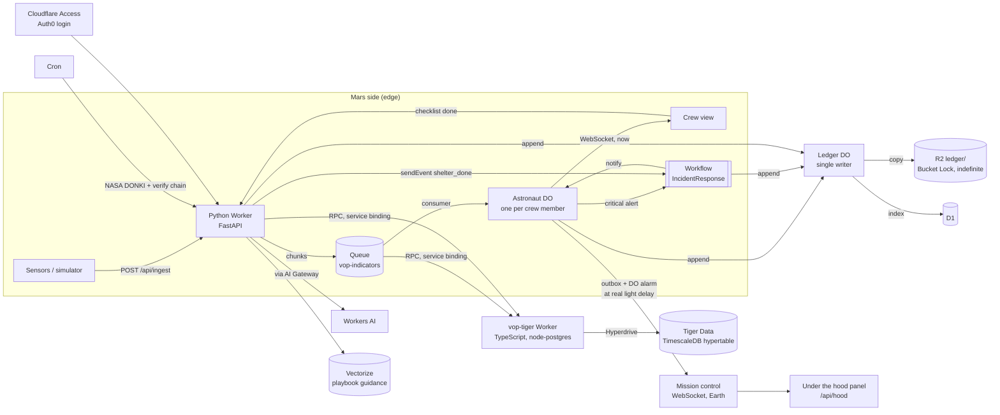

# Vital Orbit Pulse

Crew health monitoring for a Mars transit. The edge guides the crew at once; Earth gets the same data one real
light delay later, and every decision lands in a tamper-evident black box. Everything runs on one Python Worker.

Setup and the Auth0 + Cloudflare Access steps: [PROGRESS.md](Vital%20Orbit%20Pulse/docs/PROGRESS.md).

## Access The Website
Link: https://guest.vitalorbit.health/guide

## Repository layout

Everything lives in `Vital Orbit Pulse/`. Rows marked **Cloudflare** run on, or configure, a Cloudflare product.

| Path | What it is | Cloudflare |
| --- | --- | --- |
| `frontend/` | React app (Vite, Tailwind). `DESIGN.md` is its design system | Built to `frontend/dist`, served by the Worker as **Workers static assets** |
| `backend/src/` | Python Worker: FastAPI routes, playbook engine, ledger | **Workers (Python)**, **Durable Objects** (`Astronaut`, `Ledger`), **Workflows** (`IncidentResponse`), **Queues** consumer, **Cron Triggers** |
| `backend/wrangler.jsonc` | Worker config: bindings, routes, vars | **Cloudflare**: D1, R2, Queues, Vectorize, Workers AI, AI Gateway, service binding to `vop-tiger` |
| `backend/migrations/` | SQL schema | **D1** migrations |
| `backend/playbooks/` | Mission playbooks (YAML), uploaded to the Worker | Stored in **R2** and **D1** |
| `backend/tests/`, `backend/sim/` | Assert-based tests; crew simulator | No |
| `backend/.dev.vars.example` | Local settings and secrets template | Read by **Wrangler** in local dev |
| `tigerdata/` | TypeScript Worker `vop-tiger`: the only code that talks to Tiger Data (TimescaleDB) | **Workers** + **Hyperdrive** |
| `auth0/` | Auth0 post-login Action that adds the role claims | Feeds **Cloudflare Access** |
| `docs/` | Progress log, pitch script, design screenshots, plans | No |

## Architecture



## Why Cloudflare

| Problem | Product | How it solves it |
| --- | --- | --- |
| Crew must be guided at once, with no round trip to Earth | Workers (Python) | One Worker serves the API, the WebSockets and the frontend, at the edge |
| Each astronaut needs consistent state and a live socket | Durable Objects (SQLite) | One object per crew member runs the playbook engine and holds hibernatable WebSockets |
| Earth must only see data after the real Earth-Mars light delay | Durable Object alarms | Each message goes into the object's outbox; `setAlarm` fires at the light delay of the active playbook and only then delivers to mission control. The browser only draws the countdown from the alarm time |
| Two writers must never fork the black box | Durable Objects | The Ledger object is the only writer and assigns seq and prev_hash with no await in between |
| Stored decisions must not be editable or deletable, even by us | R2 Bucket Lock | An indefinite lock rule on `ledger/` refuses every overwrite and delete (error 10069). The tamper demo shows R2 refusing, then edits a separate demo-only copy so verify can show the hash check catching it |
| A critical alert needs a follow-up that survives restarts and waits minutes | Workflows (Python) | `IncidentResponse`: notify crew, `wait_for_event` for the shelter checklist with a timeout, page the commander on timeout, log every step to the ledger |
| Sensor bursts must not overload the engine | Queues | Ingest returns 202 at once; the consumer feeds each astronaut object in order, with retries |
| Searchable records for dashboards | D1 | Latest readings, alerts, checklists, the ledger index and incidents |
| The assistant must explain, not diagnose, and stay observable | Workers AI + AI Gateway + Vectorize | Answers are grounded in the playbook's guidance; every call goes through AI Gateway for logs and limits, and its latency shows in the Under the hood panel |
| Months of readings must stay queryable for trends | Hyperdrive + Tiger Data | See below |
| Space weather must stay current | Cron Triggers | Every 6 hours: refresh NASA DONKI events and re-verify the ledger chain |
| Only the crew and mission control may get in | Cloudflare Access | Auth0 login in front of the Worker; the Worker checks the Access JWT on every request and socket |
| Judges should see the platform working | Under the hood panel | Live: active Durable Objects and their next alarms, queue backlog, last Workers AI call and latency, ledger head hash, running Workflows |

## Tiger Data

Tiger Data (managed TimescaleDB on Postgres) keeps the long-term record that D1 and the Durable Objects do not:

- `indicators` is a hypertable on `time` with every reading (entity, domain, metric, value, unit, source). The queue
  consumer writes each batch in one insert; a unique key makes queue retries harmless. NASA DONKI events go to
  `donki_events`.
- `GET /api/astronauts/{id}/history?days=30|90|180` returns daily averages from `time_bucket('1 day', time)`,
  shown as one trend chart per domain in the crew view.
- Once per mission day each astronaut object reads 90 days of daily averages: indicators with no readings yet start
  from that baseline instead of learning from zero, and domains with a chronic horizon get a weekly trend that the
  twin forecast shows next to its fast slope.

Python Workers have no TCP sockets for a Postgres driver (tested: `socket` is refused, so pg8000 cannot connect).
The small TypeScript Worker in `tigerdata/` owns the database through Hyperdrive and exposes RPC methods; the Python
Worker calls it over a service binding. It has no public URL.

## Develop

Commands run from inside `Vital Orbit Pulse/`. The Worker, from `backend/`:

```bash
uv run pywrangler dev
```

```bash
uv run python tests/test_ledger.py
```

The frontend, from `frontend/` (it proxies `/api` and `/ws` to the Worker on port 8787):

```bash
npm install && npm run dev
```

Before a deploy, build the frontend so the Worker has `frontend/dist` to serve:

```bash
npm run build
```

Deploy the Tiger Worker first (the Python Worker binds to it), from `tigerdata/`:

```bash
npm install && npx wrangler deploy
```

The ledger lock rule, once per bucket:

```bash
npx wrangler r2 bucket lock add vital-orbit-pulse ledger-forever ledger/ --retention-indefinite
```
